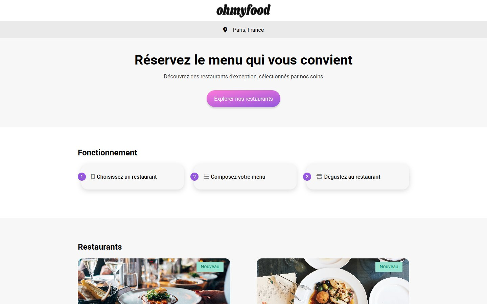
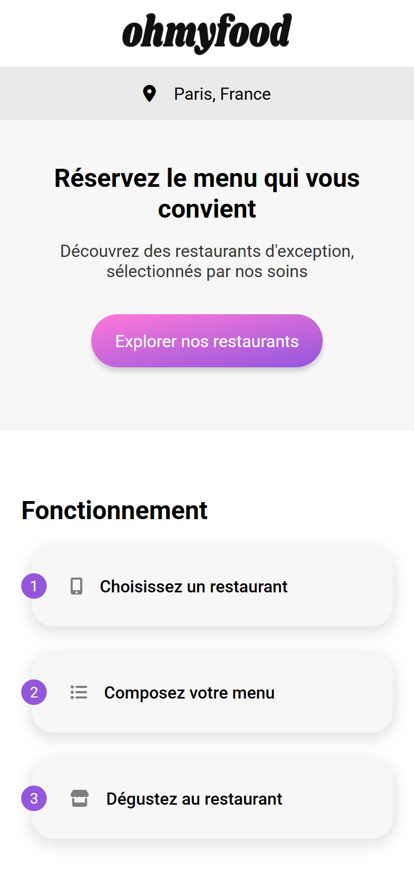

# Ohmyfood

Integration of a mobile-first mockup for a restaurant booking site: a home page and four restaurant menu pages, in HTML and Sass, with CSS-only animations.

**Live site:** https://idento.github.io/Ohmyfood/

| Desktop | Mobile |
| --- | --- |
|  |  |

## What was done

- Mobile-first layout, adapted to tablet and desktop.
- Home page (location, how it works, restaurant cards) and four menu pages.
- CSS-only animations: page loader, menu dishes appearing one after another with staggered delays, "like" heart that fills when a dish is selected, button hover effects.
- Styles written in Sass (variables, mixins with parameters, nesting), compiled to `assets/css/style.css`.

## Stack

HTML, Sass/CSS. No framework and no JavaScript of my own (the only script is the Font Awesome icon kit). Deployed on GitHub Pages with GitHub Actions.

## Run locally

Open `index.html` in a browser, or serve the folder with any static server.
